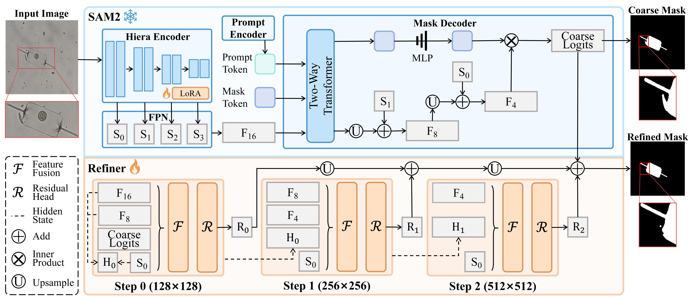

# PhySeg: Progressively Refining SAM for Accurate Phytoplankton Segmentation
Official implementation of **Progressively Refining SAM for Accurate Phytoplankton Segmentation**.

> **Progressively Refining SAM for Accurate Phytoplankton Segmentation**  
> Jialin Li, Jinkun Jiang, Yuezun Li\*, and Junyu Dong  
> School of Computer Science and Technology, Ocean University of China, Qingdao, China  
> \* Corresponding author
>
> **Abstract:**  
> Accurate phytoplankton segmentation is essential for ecological monitoring, yet it remains largely underexplored due to the subtle visual characteristics of phytoplankton and the scarcity of pixel-level annotations. To address these challenges, we propose PhySeg, a SAM-based segmentation framework equipped with a lightweight refinement module that progressively restores fine-grained details through multi-scale feature fusion. In addition, we construct a phytoplankton segmentation dataset by manually annotating instance-level masks for an existing dataset, providing a valuable resource for future research. Experimental results demonstrate that PhySeg improves segmentation accuracy, validating the effectiveness of the proposed module.
---

---

---
## Installation
```bash
conda create -n physeg python=3.12.13 -y
conda activate physeg
python -m pip install -r requirements.txt
```
## Dataset: PhySegD
PhySegD extends PMID2019 with **11,990 manually annotated instance masks across 9,824 images**, covering **15 genus-level categories**.

| Split | Images | Instances |
|---|---:|---:|
| Training | 6,880 | 8,378 |
| Validation | 1,968 | 2,395 |
| Test | 976 | 1,217 |
| **Total** | **9,824** | **11,990** |

Organize the COCO-format dataset as follows:

```text
data/PhySegD/
├── annotations/
│   ├── instances_train.json
│   ├── instances_val.json
│   └── instances_test.json
└── images/
    ├── train/
    ├── val/
    └── test/
```
## Framework: PhySeg
Training consists of two stages. 
### Stage 1: LoRA Adaptation
```bash
python train.py --stage lora --data-root data/PhySegD --output-dir runs/lora
```
### Stage 2: Progressive Refinement
```bash
python train.py --stage refiner --data-root data/PhySegD --lora-checkpoint runs/lora/best.pt --output-dir runs/refiner
```
### Run these commands from the repository root.
**Test set:**
```bash
python evaluate.py --data-root data/PhySegD --split test --output-dir results/test
```
**Validation set:**
```bash
python evaluate.py --data-root data/PhySegD --split val --output-dir results/val
```
**Place the standalone main-experiment checkpoint at:**
```text
checkpoints/physeg.pt
```
This single file contains the **SAM2.1 Large image backbone, LoRA parameters, and Refiner parameters**.

**arxiv链接**: 

**权重和数据集**:
https://pan.baidu.com/s/18b09leGGkA4P0iNjLn6bcg?pwd=j8y7
